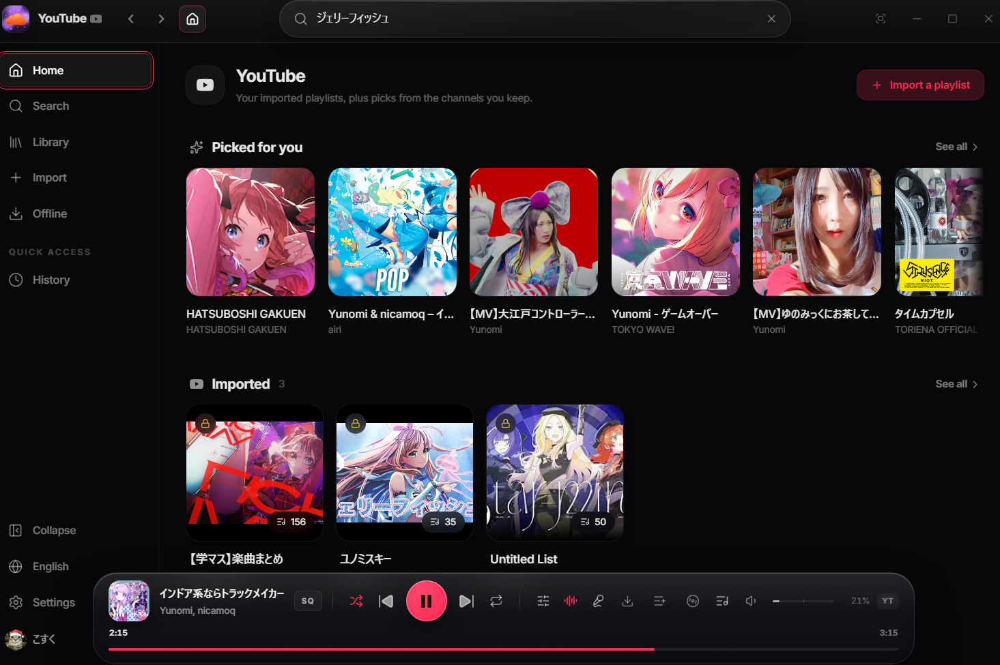
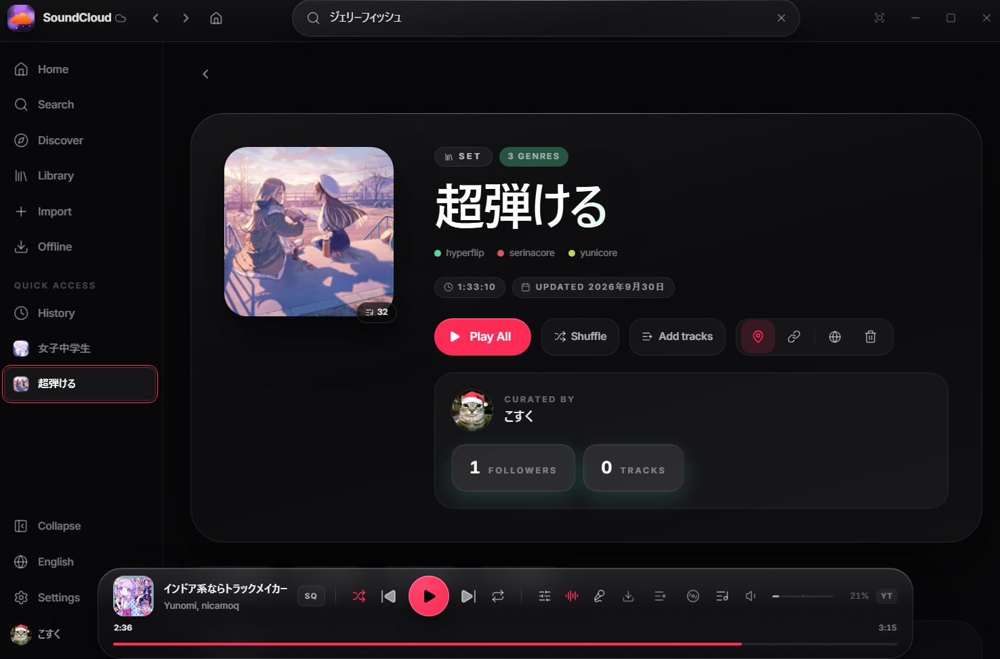

<p align="center">
  
</p>

<h1 align="center">Sonora</h1>

<p align="center">
  <a href="#english"><b>English</b></a> ｜ <a href="#日本語"><b>日本語</b></a>
</p>

<p align="center">
  <a href="https://github.com/b1skOwO/Sonora/releases/latest"></a>
  
  
  
</p>

---

## English

<p align="center">
  <b>A desktop music player for SoundCloud <i>and</i> YouTube.</b><br />
  One window, two services — switch with a single click.
</p>

### Download

**Windows** — grab the signed installer from the [latest release](https://github.com/b1skOwO/Sonora/releases/latest) and run it. The first install is manual; from then on Sonora updates itself in-app.

Windows may show a SmartScreen warning because the installer isn't code-signed — choose **More info → Run anyway**.

**Linux / macOS** — no prebuilt installers yet; [build from source](#build-from-source).

### Screenshots

**YouTube mode** — imported playlists plus picks from the channels you keep:



**SoundCloud mode** — full playlist pages with genres, stats and one-click playback:



### Why Sonora?

Most players lock you into one service. Sonora treats **SoundCloud and YouTube as equals**: flip the brand in the titlebar and the whole app — home, search, pins, volume — follows the service. Your YouTube imports live next to your SoundCloud library, playable in the same queue, DJ decks and offline cache.

### Features

#### Two services, one player
- **One-click SoundCloud ⇄ YouTube switch** in the titlebar (Home, Search, sidebar pins and volume all follow the service)
- **Per-service volume** — SoundCloud and YouTube remember their own level
- **Unified queue** — mix SoundCloud and YouTube tracks in one playback session

#### Imports
- **YouTube playlists** — paste a link, get a local playlist (audio downloads on first play via yt-dlp)
- **Replace with the artist's channel** — re-uploads and lyric videos are swapped for the artist's own upload when found (optional, on by default)
- **Spotify playlists** — matched onto YouTube, preferring the artist's official channel
- **Yandex Music likes** — import your likes into SoundCloud

#### Playback & DJ
- Native playback engine in Rust (rodio + symphonia) with high-quality resampling
- **Two-deck DJ mode** — BPM + Sync, crossfade, auto-mix, DJ filter, flanger, waveform
- **DJ keyboard shortcuts** — play, cue, sync, crossfader and auto-mix on keys (remappable in Settings → General)
- Playback speed & pitch controls, A–B loop, shuffle / repeat
- **Automatic volume leveling** — quiet and loud tracks are matched to the same loudness (-14 LUFS, ITU-R BS.1770 / EBU R128) with a static per-track gain: no limiter, no compression, dynamics untouched (can be turned off in Settings)
- Hover-to-preview tracks without interrupting playback

#### Library & discovery
- Likes, playlists, followings, history, fresh drops from artists you follow
- **SoundWave recommendations** — a similar-tracks block on every track page and an endless wave on artist pages, tuned by likes / skips / dislikes feedback
- Discover catalogs (albums, artists, genres), search by text or lyrics
- **Lyrics** — synced karaoke + plain lyrics, manual search fallback (works for YouTube tracks too)
- Floating comments during playback

#### Offline & performance
- **Offline cache** with selectable format (m4a / mp3 / wav) and size limit; likes get a protected cache
- **Memory saver** — caps WebView heap/GPU caches; memory is auto-released while minimized
- Permanent on-disk image cache, virtualized lists

#### Integrations
- **Discord Rich Presence** with a per-service "Listen on SoundCloud / YouTube" button that opens the track
- System media keys + OS media popup (Windows SMTC / MPRIS), system tray + mini player
- **In-app updates** — new builds install from GitHub releases without touching a terminal (see [Updating](#updating))

### What this fork adds

Built on top of [zxcloli666/SoundCloud-Desktop](https://github.com/zxcloli666/SoundCloud-Desktop), this fork focuses on YouTube parity and everyday-player comfort:

- **YouTube as a first-class service** — one-click switching, per-service volume and pins, a YouTube home with picks from your channels, YouTube search, YouTube lyrics
- **Two-deck DJ mode** — crossfader, tempo + BPM sync, 3-band EQ, DJ filter, flanger, auto-mix, per-deck waveform
- **Imports that prefer the artist** — Spotify matching and the YouTube "replace with the artist's channel" option swap re-uploads for the artist's own upload; second-chance matching rescues "not found" tracks
- **Offline cache you control** — m4a / mp3 / wav choice, size limit, protected likes cache, and a peak-safe pipeline with no limiter (dynamics untouched)
- **Memory saver** — heap/GPU caps, streaming decode without full-track RAM buffers, automatic release while minimized
- **Sane window behavior** — close quits; staying in the tray is opt-in

### Build from source

#### Requirements

| Tool | Version | Notes |
|---|---|---|
| [Node.js](https://nodejs.org/) | 22+ | CI pins 22 |
| [pnpm](https://pnpm.io/) | 10+ | `corepack enable` also works |
| [Rust](https://rustup.rs/) | stable | via rustup |

Platform prerequisites (Tauri):

- **Windows** — Windows 10 (1809+) / 11, [Visual Studio C++ Build Tools](https://visualstudio.microsoft.com/visual-cpp-build-tools/) ("Desktop development with C++"), WebView2 (preinstalled on Win10/11)
- **Linux** — webkit2gtk, rsvg, soup + build tools; see [Tauri prerequisites](https://tauri.app/start/prerequisites/)
- **macOS** — Xcode Command Line Tools

No manual setup for media tools: **ffmpeg and yt-dlp are downloaded by the app itself** on first use (import / transcode flows).

#### Setup & build

```bash
git clone https://github.com/b1skOwO/Sonora.git
cd Sonora/desktop
pnpm install --frozen-lockfile
```

Run in development mode (hot reload):

```bash
pnpm tauri dev
```

Production build (installer + portable bundle). Release builds must be signed
for the updater, so point `TAURI_SIGNING_PRIVATE_KEY` at your key first:

```bash
export TAURI_SIGNING_PRIVATE_KEY=~/.tauri/sonora.key
pnpm tauri build
```

Artifacts land in `desktop/src-tauri/target/release/bundle/`.

#### Checks (same as CI)

```bash
pnpm exec tsc --noEmit   # TypeScript
pnpm exec vite build     # frontend build
cargo check              # Rust (run in desktop/src-tauri)
cargo test --lib         # Rust tests
```

### Updating

Sonora updates itself: it checks the release feed on startup, and **Settings → General → Updates** has a manual check plus an auto-check toggle. The update dialog downloads the signed installer, verifies its minisign signature, and installs it in the background (passive NSIS — a small progress window, no wizard); the app quits and reopens by itself.

Releasing a new build: bump the version in `desktop/package.json`, `desktop/src-tauri/tauri.conf.json` and `desktop/src-tauri/Cargo.toml`, then push a tag:

```bash
git tag v8.4.14 && git push origin v8.4.14
```

CI builds and signs the installer, publishes the GitHub Release, and generates the updater manifest (`latest.json`). Keep the signing key safe — losing it means existing installs can no longer receive signed updates.

### Origin

Sonora is a fork of **[zxcloli666/SoundCloud-Desktop](https://github.com/zxcloli666/SoundCloud-Desktop)** — a native SoundCloud desktop client (Tauri 2 + React 19). All credit for the original client goes to its authors. Sonora extends it with YouTube playback, service switching, DJ mode, import flows and the changes listed above.

### Disclaimer — use at your own risk

- This is an **unofficial, community-built** client. It is **not affiliated with, endorsed by, or connected to SoundCloud, YouTube/Google, or Spotify**.
- Downloading, caching or converting audio may **violate the terms of service** of those platforms. Depending on your country, it may also infringe copyright law.
- Using third-party clients can lead to **account restrictions or bans** on those services.
- **You are solely responsible for how you use this software.** The authors accept no liability for any damage, data loss, account action or legal consequence arising from its use.
- All trademarks (SoundCloud, YouTube, Spotify, Discord) belong to their respective owners.

### License

MIT. See [LICENSE](LICENSE).

---

## 日本語

<p align="center">
  <b>SoundCloudもYouTubeも聴けるデスクトップ音楽プレイヤー。</b><br />
  タイトルバーのワンクリックで2つのサービスを切り替え。
</p>

### ダウンロード

**Windows** — [最新リリース](https://github.com/b1skOwO/Sonora/releases/latest)から署名済みインストーラーをダウンロードして実行してください。初回のみ手動インストールで、以降はアプリ内で自動更新されます。

インストーラーはコード署名されていないため、WindowsのSmartScreen警告が出ることがあります — **詳細情報 → 実行** を選んでください。

**Linux / macOS** — ビルド済みインストーラーはまだありません（[ソースからビルド](#ソースからビルド)）。

### スクリーンショット

**YouTubeモード** — インポートしたプレイリスト＋よく聴くチャンネルからのおすすめ：


**SoundCloudモード** — ジャンル・統計付きのプレイリストページ、ワンクリック再生：


### なぜSonoraか？

普通のプレイヤーは1つのサービスに縛られます。Sonoraは **SoundCloudとYouTubeを対等に扱います**：タイトルバーのブランドをクリックするだけで、ホーム・検索・ピン・音量まですべて追従。YouTubeのインポート曲もSoundCloudのライブラリと並び、同じキュー・DJデッキ・オフラインキャッシュで再生できます。

### 機能

#### 2サービス、1つのプレイヤー
- **SoundCloud ⇄ YouTubeをワンクリック切り替え**（ホーム・検索・サイドバーのピン・音量が連動）
- **サービス別音量** — SoundCloudとYouTubeで音量を個別に記憶
- **統合キュー** — SoundCloudとYouTubeの曲を混ぜて連続再生

#### インポート
- **YouTubeプレイリスト** — リンクを貼るだけでローカルプレイリスト化（音声は初回再生時にyt-dlpで取得）
- **アーティストのチャンネルに置き換え** — 転載・歌詞動画を、見つかれば本人の公式アップロードに差し替え（任意、デフォルトON）
- **Spotifyプレイリスト** — YouTube上でマッチング。本人チャンネルを優先
- **Yandex Musicのいいね** — SoundCloud側に取り込み

#### 再生・DJ
- Rust製再生エンジン（rodio + symphonia）、高品質リサンプリング
- **2デッキDJモード** — BPM＋Sync、クロスフェード、オートミックス、DJフィルター、フランジャー、波形表示
- **DJキーボードショートカット** — 再生・Cue・Sync・クロスフェード・オートミックスをキー操作（設定 → 一般でリマップ可）
- 再生速度・ピッチ調整、A–Bループ、シャッフル／リピート
- **音量の自動均一化** — 静かな曲も大きな曲も同じラウドネス（-14 LUFS、ITU-R BS.1770 / EBU R128準拠）に揃える。曲ごとの静的ゲインのみで、リミッターやコンプレッションは不使用（設定でオフ可）
- 再生を邪魔しないホバープレビュー

#### ライブラリ・発見
- いいね、プレイリスト、フォロー、履歴、フォロー中アーティストの新譜
- **SoundWaveレコメンド** — 曲ページの類似トラックブロック＋アーティストページの無限ウェーブ（いいね／スキップ／低評価で学習）
- Discoverカタログ（アルバム・アーティスト・ジャンル）、テキスト／歌詞で検索
- **歌詞** — 同期カラオケ＋プレーン歌詞、手動検索付き（YouTubeの曲にも対応）
- 再生中のフローティングコメント

#### オフライン・軽量化
- **オフラインキャッシュ**（形式選択可: m4a / mp3 / wav、容量上限あり）。いいねは保護キャッシュ
- **メモリ節約モード** — WebViewのヒープ／GPUキャッシュを制限。最小化中は自動でメモリ解放
- 画像の永続ディスクキャッシュ、リストの仮想化

#### 連携
- **Discord Rich Presence** — サービス別の「Listen on SoundCloud / YouTube」ボタン付き（押すとその曲が開く）
- メディアキー＋OSメディアポップアップ（Windows SMTC / MPRIS）、トレイ＋ミニプレイヤー
- **アプリ内アップデート** — ターミナル不要でGitHubリリースから更新（[アップデート](#アップデート)参照）

### このフォークでの追加分

[zxcloli666/SoundCloud-Desktop](https://github.com/zxcloli666/SoundCloud-Desktop) をベースに、YouTubeとの対等な統合と「普段使いの快適さ」に振ったフォークです：

- **YouTubeを一人前のサービスとして統合** — ワンクリック切り替え、サービス別音量・ピン、チャンネル起点のおすすめ付きYouTubeホーム、YouTube検索、YouTube曲の歌詞
- **2デッキDJモード** — クロスフェーダー、テンポ＋BPM同期、3バンドEQ、DJフィルター、フランジャー、オートミックス、デッキ別波形
- **アーティスト優先のインポート** — SpotifyマッチングとYouTubeの「本人のチャンネルに置き換え」で転載を公式アップロードに差し替え。救済マッチングで「not found」を減らす
- **思い通りのオフラインキャッシュ** — m4a / mp3 / wav選択、容量上限、いいね保護、リミッターなしのピークセーフ処理（ダイナミクス不変）
- **メモリ節約** — ヒープ／GPU上限、曲全体をRAMに載せないストリーム再生、最小化中の自動解放
- **まともなウィンドウ動作** — 閉じれば終了。トレイ常駐は任意設定

### ソースからビルド

#### 必要なもの

| ツール | バージョン | 備考 |
|---|---|---|
| [Node.js](https://nodejs.org/) | 22+ | CIは22固定 |
| [pnpm](https://pnpm.io/) | 10+ | `corepack enable`でも可 |
| [Rust](https://rustup.rs/) | stable | rustup経由 |

OS別の前提条件（Tauri）：

- **Windows** — Windows 10 (1809+) / 11、[Visual Studio C++ Build Tools](https://visualstudio.microsoft.com/visual-cpp-build-tools/)（「C++によるデスクトップ開発」）、WebView2（Win10/11は標準搭載）
- **Linux** — webkit2gtk、rsvg、soup＋ビルドツール。詳細は[Tauri公式の前提条件](https://tauri.app/start/prerequisites/)参照
- **macOS** — Xcode Command Line Tools

メディアツールは手動導入不要：**ffmpegとyt-dlpは初回利用時にアプリが自動取得**します（インポート／変換機能用）。

#### セットアップ＆ビルド

```bash
git clone https://github.com/b1skOwO/Sonora.git
cd Sonora/desktop
pnpm install --frozen-lockfile
```

開発モード（ホットリロード）で起動：

```bash
pnpm tauri dev
```

リリースビルド（インストーラー＋ポータブル）。リリースビルドは署名が必須なので、先に `TAURI_SIGNING_PRIVATE_KEY` に鍵を設定してください：

```bash
export TAURI_SIGNING_PRIVATE_KEY=~/.tauri/sonora.key
pnpm tauri build
```

成果物は `desktop/src-tauri/target/release/bundle/` に出ます。

#### チェック（CIと同内容）

```bash
pnpm exec tsc --noEmit      # TypeScript
pnpm exec vite build        # フロントビルド
cargo check                 # Rust (desktop/src-tauri にて)
cargo test --lib            # Rustテスト
```

### アップデート

Sonoraは自分で更新します：起動時にリリースフィードを確認し、**設定 → 一般 → Updates** に手動チェックと自動チェックのトグルがあります。更新ダイアログは署名済みインストーラーをダウンロード→minisign署名を検証→バックグラウンドでインストール（passive NSIS：小さな進捗ウィンドウのみ、ウィザードなし）。アプリは自動で終了→再起動します。

新しいビルドのリリース：`desktop/package.json`・`desktop/src-tauri/tauri.conf.json`・`desktop/src-tauri/Cargo.toml` のバージョンを上げてからタグをpushします：

```bash
git tag v8.4.14 && git push origin v8.4.14
```

CIがインストーラーをビルド・署名してGitHubリリースを公開し、更新用マニフェスト（`latest.json`）も生成します。署名鍵は大切に保管してください — 失うと既存インストールへ更新を配れなくなります。

### フォーク元

Sonoraは **[zxcloli666/SoundCloud-Desktop](https://github.com/zxcloli666/SoundCloud-Desktop)**（Tauri 2 + React 19製のネイティブSoundCloudクライアント）のフォークです。オリジナルのクレジットはすべて原作者に帰属します。SonoraはここにYouTube再生、サービス切り替え、DJモード、各種インポート等を追加したものです。

### 免責 — 利用は自己責任で

- 本アプリは**非公式のコミュニティ製クライアント**です。**SoundCloud、YouTube/Google、Spotifyとは一切関係がなく、推奨・公認も受けていません**。
- 音声のダウンロード・キャッシュ・変換は、各プラットフォームの**利用規約に違反する可能性**があります。国によっては著作権法に触れる場合もあります。
- サードパーティ製クライアントの利用により、各サービスのアカウントが**制限・凍結される可能性**があります。
- **本ソフトの利用に関する一切の責任は利用者本人が負います**。損害・データ消失・アカウント措置・法的な問題について、作者は責任を負いません。
- 各商標（SoundCloud、YouTube、Spotify、Discord）はそれぞれの権利者に帰属します。

### ライセンス

MIT。詳細は [LICENSE](LICENSE) を参照。
